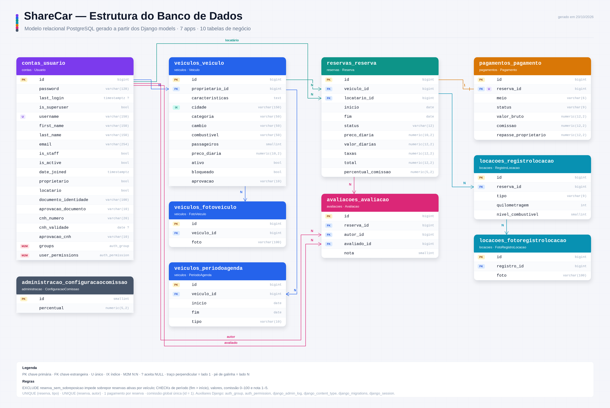

# Aluguel de Carro — base Django/PostgreSQL

Fonte de verdade: `AluguelCarro — Orientações do Projeto.docx`.
Esta entrega cobre estrutura e modelagem inicial, não o MVP funcional.

## Documentação

- [Diagrama da estrutura do banco de dados](docs/diagrama-banco-de-dados.png)
- [Tutorial de instalação do Docker e Docker Compose no Windows](docs/tutorial-docker-windows.md)

## Tutorial para colaboradores — Docker e Podman

### 1. Instalar uma das ferramentas

Os comandos deste tutorial usam Bash/Zsh. No Windows, use o
[tutorial dedicado com PowerShell e Docker Desktop](docs/tutorial-docker-windows.md).

**Docker:** instale o [Docker Engine](https://docs.docker.com/engine/install/)
e o plugin [Docker Compose](https://docs.docker.com/compose/install/) no Linux,
ou o Docker Desktop no Windows/macOS. Inicie o serviço/aplicativo e verifique:

```bash
docker --version
docker compose version
docker info
```

**Podman:** no Fedora:

```bash
sudo dnf install podman podman-compose
```

No Ubuntu/Debian com esses pacotes disponíveis:

```bash
sudo apt update
sudo apt install podman podman-compose
```

No macOS/Windows, instale o [Podman](https://podman.io/docs/installation),
o provedor `podman-compose` e inicie a máquina virtual:

```bash
podman machine init
podman machine start
```

No Linux, a máquina virtual não é necessária. Verifique:

```bash
podman --version
podman-compose --version
podman info
```

Use Docker Compose v2 ou uma versão atual do Podman Compose. O mesmo
`docker-compose.yml` funciona nos dois. Nos exemplos Podman usamos
`podman-compose`; `podman compose` também funciona quando esse provedor está
configurado. Execute Podman sempre com o mesmo usuário, sem alternar com sudo.

### 2. Preparar o projeto e as variáveis

Depois de clonar o repositório, entre na pasta que contém `manage.py` e execute:

```bash
cp .env.example .env
```

Preencha `DJANGO_SECRET_KEY` e `POSTGRES_PASSWORD` no `.env`. Para gerar dois
valores aleatórios sem instalar Python no host, use uma das opções:

```bash
# Docker
docker run --rm docker.io/library/python:3.14-slim python -c 'import secrets; print(secrets.token_hex(32)); print(secrets.token_hex(32))'

# Podman
podman run --rm docker.io/library/python:3.14-slim python -c 'import secrets; print(secrets.token_hex(32)); print(secrets.token_hex(32))'
```

Use a primeira linha como chave Django e a segunda como senha do banco.
As demais variáveis já têm padrões locais. O `.env` é ignorado pelo Git e
excluído da imagem; o Compose injeta as variáveis em tempo de execução.

| Configuração | Padrão | Onde ajustar |
| --- | --- | --- |
| Python | 3.14 slim | `Dockerfile` |
| PostgreSQL | 18, patches da mesma versão principal | `docker-compose.yml` |
| Projeto Django | `config` | `config/`, `manage.py` e `Dockerfile` |
| Dependências | versões fixadas | `requirements.txt` |
| Django no host | `127.0.0.1:8000` | `DJANGO_BIND_ADDRESS`, `DJANGO_HOST_PORT` |
| PostgreSQL no host | `127.0.0.1:5432` | `POSTGRES_BIND_ADDRESS`, `POSTGRES_HOST_PORT` |
| Nome do banco/usuário | `aluguel_carro` | `POSTGRES_DB`, `POSTGRES_USER` |
| Espera pelo banco | 60 s, conexão com timeout de 5 s | `DB_WAIT_TIMEOUT`, `POSTGRES_CONNECT_TIMEOUT` |

Este ambiente é de desenvolvimento acadêmico: usa `runserver` e `DEBUG=True`.
São exatamente dois serviços: `web` (Django) e `db` (PostgreSQL). O pgAdmin é
instalado na máquina do colaborador, não é um terceiro container.

**Endereços diferentes:** dentro do Compose, Django conecta em `db:5432`.
No host, psql/pgAdmin usam `127.0.0.1` e `POSTGRES_HOST_PORT`. As variáveis
`POSTGRES_HOST` e `POSTGRES_PORT` do `.env` servem para executar Django fora
dos containers; o Compose substitui essas duas pelo endereço interno correto.
Se a porta 5432 já estiver ocupada, use `POSTGRES_HOST_PORT=5433`. Para rodar
Django diretamente no host nesse caso, ajuste também `POSTGRES_PORT=5433`.

### 3. Construir e iniciar

**Docker:**

```bash
docker compose up -d --build
docker compose ps
docker compose logs -f web
```

**Podman:**

```bash
podman-compose up -d --build
podman-compose ps
podman-compose logs -f web
```

#### Scripts auxiliares

Os dois scripts da raiz automatizam o ciclo dos containers e detectam Docker
Compose ou Podman Compose:

```bash
./start_containers.sh              # reconstrói, recria e sobe os serviços
./start_containers.sh --no-build   # sobe sem reconstruir
./start_containers.sh --reuse      # reutiliza containers existentes
./start_containers.sh --follow     # sobe e acompanha os logs do web
./stop_containers.sh               # para os containers, preservando os dados
./stop_containers.sh --down        # remove containers e rede, mantendo volumes
```

O `start_containers.sh` recria os containers por padrão (`--force-recreate`),
pois o Podman Compose pode manter um container antigo mesmo após reconstruir a
imagem. Use `--reuse` apenas quando tiver certeza de que o código atual já está
no container.

Para forçar um runtime, use `CONTAINER_ENGINE=podman` ou
`CONTAINER_ENGINE=docker`. A remoção dos volumes é destrutiva e exige
`./stop_containers.sh --down --volumes` seguido da confirmação digitada, ou
`--yes` para automação.

Ctrl+C encerra apenas o acompanhamento dos logs. O serviço `db` tem healthcheck
com `pg_isready`. Além da ordem de inicialização, o entrypoint da aplicação faz
uma consulta autenticada `SELECT 1`, aguardando o banco de verdade. Se o limite
de espera for atingido ou uma migração falhar, o servidor Django não é iniciado.
Essa espera não depende de suporte a `depends_on.condition` do provedor Compose.

Quando o banco está pronto, o entrypoint executa `migrate --noinput` e inicia
Django. Na primeira execução a imagem PostgreSQL cria banco e usuário a partir
das variáveis; a migração cria `btree_gist` e a configuração de comissão de 15%.
Não é preciso executar os comandos de criação de banco da instalação local.

Crie o administrador com a ferramenta escolhida:

```bash
docker compose exec web python manage.py createsuperuser
# ou
podman-compose exec web python manage.py createsuperuser
```

Acesse **http://127.0.0.1:8000/admin/**. A página `/` ainda retorna 404 porque
o projeto está na etapa de estrutura/models.

### 4. Alterações no código e migrações

O código é copiado para a imagem, sem bind mount do diretório de trabalho.
Após editar Python, dependências ou configurações, reconstrua:

```bash
docker compose up -d --build
# ou
podman-compose up -d --build
```

Para **criar migrações após editar models**, reconstrua primeiro como acima.
Depois gere e copie somente os diretórios de migrações de volta ao repositório:

**Docker:**

```bash
docker compose exec web python manage.py makemigrations
docker compose exec -T web sh -c 'tar -cf - apps/*/migrations' | tar -xf -
docker compose exec web python manage.py migrate
docker compose up -d --build
```

**Podman:**

```bash
podman-compose exec web python manage.py makemigrations
podman-compose exec -T web sh -c 'tar -cf - apps/*/migrations' | tar -xf -
podman-compose exec web python manage.py migrate
podman-compose up -d --build
```

Os comandos `tar` são executados na raiz do projeto e preservam os arquivos
gerados fora do container antes da reconstrução. Revise e versione as migrações.
Para migrações já recebidas pelo Git, basta reconstruir: o entrypoint as aplica.

Verificação manual:

```bash
docker compose exec web python manage.py check
docker compose exec web python manage.py showmigrations
# ou
podman-compose exec web python manage.py check
podman-compose exec web python manage.py showmigrations
```

### 5. Conectar pelo terminal da sua máquina

Instale o cliente `psql`: `sudo apt install postgresql-client` no Ubuntu/Debian
ou `sudo dnf install postgresql` no Fedora. Com as portas padrão:

```bash
psql -h 127.0.0.1 -p 5432 -U aluguel_carro -d aluguel_carro -W
```

Informe a senha definida em `POSTGRES_PASSWORD`. Se alterou nome, usuário ou
porta no `.env`, substitua os valores correspondentes no comando. Dentro do
psql, `\dt` lista as tabelas e `\q` encerra a sessão.

Também é possível usar o cliente instalado no próprio container:

```bash
docker compose exec db sh -c 'psql -U "$POSTGRES_USER" -d "$POSTGRES_DB"'
# ou
podman-compose exec db sh -c 'psql -U "$POSTGRES_USER" -d "$POSTGRES_DB"'
```

### 6. Conectar pelo pgAdmin

Instale e abra o [pgAdmin Desktop](https://www.pgadmin.org/download/) na sua
máquina. Em **Servers → Register → Server**:

| Campo | Valor |
| --- | --- |
| General → Name | ShareCar local |
| Connection → Host name/address | `127.0.0.1` |
| Connection → Port | `5432` ou `POSTGRES_HOST_PORT` |
| Connection → Maintenance database | valor de `POSTGRES_DB` |
| Connection → Username | valor de `POSTGRES_USER` |
| Connection → Password | valor de `POSTGRES_PASSWORD` |

Salve e abra **Databases → aluguel_carro → Schemas → public → Tables**.
O banco fica acessível fora dos containers, somente na máquina local por padrão.
Para acesso de outra máquina, configure `POSTGRES_BIND_ADDRESS` com o IP da
interface desejada, libere a porta no firewall e use esse IP no cliente.

### 7. Persistência, parada e remoção

Os volumes nomeados são:

- `postgres_data`: banco, montado em `/var/lib/postgresql`, caminho adequado à
  imagem PostgreSQL 18 (dados em subdiretório versionado).
- `media_data`: fotos em `/app/media`.
- `private_media_data`: documentos em `/app/private_media`.

O Compose prefixa os nomes com o nome do projeto (normalmente a pasta do
repositório). Continue usando o mesmo diretório/nome de projeto para reencontrar
os volumes. Docker e Podman têm armazenamentos distintos; alternar a ferramenta
não transfere automaticamente os dados entre elas.

| Operação | Docker | Podman |
| --- | --- | --- |
| Parar mantendo containers e volumes | `docker compose stop` | `podman-compose stop` |
| Retomar | `docker compose start` | `podman-compose start` |
| Reiniciar | `docker compose restart` | `podman-compose restart` |
| Remover containers/rede, mantendo dados | `docker compose down` | `podman-compose down` |
| Recriar usando os dados existentes | `docker compose up -d` | `podman-compose up -d` |
| Listar volumes | `docker volume ls` | `podman volume ls` |

**Para preservar os dados, não use `down -v`, `down --volumes` nem remova os
volumes manualmente.** Alterar `POSTGRES_PASSWORD`, usuário ou banco no `.env`
não modifica um banco já inicializado; nesse caso altere o usuário/banco via SQL
e mantenha o `.env` sincronizado. Atualizações de versão principal do PostgreSQL
exigem procedimento de migração do banco, não apenas troca da tag da imagem.

### 8. Diagnóstico rápido

- Porta ocupada: altere `POSTGRES_HOST_PORT` ou `DJANGO_HOST_PORT` e execute `up -d`.
- Banco não fica pronto: consulte `docker compose logs db web` ou
  `podman-compose logs db web`; confira as credenciais e o histórico do volume.
- Alteração de código não apareceu: execute `up -d --build`.
- `Invalid HTTP_HOST`: adicione o host em `DJANGO_ALLOWED_HOSTS`, separado por
  vírgulas, e recrie os containers com `up -d`.

## Estrutura

```text
ShareCar/
├── AluguelCarro — Orientações do Projeto.docx
├── manage.py
├── requirements.txt
├── Dockerfile
├── docker-compose.yml
├── start_containers.sh       # Sobe os containers (Docker/Podman)
├── stop_containers.sh        # Para ou remove os containers
├── .dockerignore
├── .gitattributes
├── docker/entrypoint.sh
├── .env.example
├── .gitignore
├── README.md
├── config/
│   ├── __init__.py
│   ├── settings.py           # PostgreSQL, .env, aplicações e diretórios
│   ├── urls.py               # Admin e rota da Home
│   ├── asgi.py
│   └── wsgi.py
├── apps/
│   ├── __init__.py
│   ├── core/                # Home e base em templates/core/
│   ├── contas/              # Usuario: autenticação, papéis e documentos
│   ├── veiculos/            # Veiculo, FotoVeiculo, PeriodoAgenda
│   ├── reservas/            # Reserva, exclusão de sobreposição no PostgreSQL
│   ├── pagamentos/          # Pagamento simulado
│   ├── locacoes/            # RegistroLocacao, FotoRegistroLocacao
│   ├── avaliacoes/          # Avaliacao entre as partes
│   └── administracao/       # ConfiguracaoComissao
│       # Apps de domínio contêm models.py e migrations/; core contém views,
│       # urls e templates.
├── templates/               # Reservado para templates globais
├── static/                  # CSS, JS, ícones e PWA (base.css)
└── docs/
    ├── diagrama-banco-de-dados.png   # Diagrama ER gerado a partir dos models
    ├── gerar_diagrama_banco.py       # Script que produz o diagrama
    ├── tutorial-docker-windows.md    # Instalação e uso no Windows
    └── prompts/                      # Histórico das solicitações
```

Diretórios gerados em execução e ignorados pelo Git: `.venv/`, `media/`
(fotos), `private_media/` (identidades) e `staticfiles/` (collectstatic).
Nenhuma rota pública de arquivos de identidade foi criada.

## Configuração e models

O conteúdo executável está nos arquivos:

- [`config/settings.py`](config/settings.py): configuração do PostgreSQL em `DATABASES`;
  lê as variáveis documentadas em [`.env.example`](.env.example).
- [`apps/contas/models.py`](apps/contas/models.py)
- [`apps/veiculos/models.py`](apps/veiculos/models.py)
- [`apps/reservas/models.py`](apps/reservas/models.py)
- [`apps/pagamentos/models.py`](apps/pagamentos/models.py)
- [`apps/locacoes/models.py`](apps/locacoes/models.py)
- [`apps/avaliacoes/models.py`](apps/avaliacoes/models.py)
- [`apps/administracao/models.py`](apps/administracao/models.py)

Chaves primárias são `BigAutoField` implícitas; `Usuario` herda a chave de
`AbstractUser`. A configuração global tem chave explícita fixa em 1.
Referências históricas usam `PROTECT`; fotos e agenda dependentes usam `CASCADE`.
Não há relacionamento N:N independente solicitado pelo documento: reservas
associam veículos a locatários, avaliações associam as partes à reserva.

### Home page e templates

A Home fica no app `core` e usa herança de templates:

- `apps/core/templates/core/base.html` — estrutura comum com `<head>`, navbar,
  `<main>` e rodapé. Blocos disponíveis: `title`, `meta_description`,
  `extra_head`, `body_class`, `navbar`, `content`, `footer` e `scripts`.
- `apps/core/templates/core/home.html` — estende `base.html` e preenche apenas
  `title`, `meta_description`, `body_class` e `content`.
- `apps/core/views.py` — `HomeView`, uma `TemplateView` sem contexto ou consulta.
- `apps/core/urls.py` — rota nomeada `core:home`, incluída em `config/urls.py`.
- `static/css/base.css` — estilos próprios; o Bootstrap 5 é carregado por CDN.

A rota `GET /` renderiza a Home. Não há formulários, banco de dados ou contexto
dinâmico nesta etapa. `STATIC_URL` foi ajustado para `/static/` para que o CSS
funcione também em rotas aninhadas.

```bash
python manage.py runserver
```

Acesse `http://127.0.0.1:8000/`. O admin continua em `/admin/`.

### Diagrama do banco de dados

[`docs/diagrama-banco-de-dados.png`](docs/diagrama-banco-de-dados.png) mostra as
tabelas, colunas, chaves e relacionamentos derivados dos models. O arquivo é
gerado por [`docs/gerar_diagrama_banco.py`](docs/gerar_diagrama_banco.py), que
usa apenas Pillow e as fontes Liberation do sistema:

```bash
.venv/bin/python docs/gerar_diagrama_banco.py
```



Ao alterar os models, atualize a lista `TABLES` e as arestas `EDGES` do script
e execute-o novamente. O script foi testado no Linux; no Windows, execute-o no
WSL ou ajuste `FONT_DIR` para a pasta das fontes Liberation instaladas.

### Interpretações adotadas

- Proprietário e locatário são flags independentes. Administração usa `is_staff`
  e permissões nativas; `is_active=False` representa conta bloqueada.
- Diárias usam datas com início inclusivo e fim exclusivo, permitindo devolução
  e nova retirada no mesmo dia. Quatro diárias equivalem a `fim - inicio = 4`.
- Solicitações já ocupam a agenda; somente recusas/cancelamentos a liberam.
  A constraint GiST impede conflitos mesmo entre gravações concorrentes.
- CNH contém número e validade. Características do carro são texto livre e os
  atributos explicitamente exigidos nos filtros. Não se inventaram placa/CPF.
- Combustível é registrado em percentual inteiro; notas vão de 1 a 5.
- Um pagamento por reserva; tentativas futuras atualizam o registro.
- Comissão incide nas diárias; taxas começam em zero. Como o destinatário de
  taxas não foi definido, o repasse é o bruto menos a comissão. O cálculo futuro
  deve arredondar valores monetários para centavos, usando Decimal.
- Média do veículo deriva das avaliações dos locatários aos proprietários nas
  reservas desse veículo; médias são calculadas, não armazenadas.
- Comissão global começa em 15% por migração de dados. A reserva guarda o
  percentual contratado para não alterar o histórico.

### Limites desta etapa

As constraints garantem períodos válidos, exclusão de reservas sobrepostas,
valores não negativos, somas financeiras, faixas de notas/comissão/combustível,
uma avaliação por autor/reserva e um registro por tipo/reserva.

As próximas etapas deverão implementar, com transações e testes:

- RN03–RN05: disponibilidade/bloqueios, CNH aprovada e válida e proibição de
  reservar o próprio carro; são regras entre tabelas, não CHECKs de uma linha.
- RN06–RN08: cálculo de diárias/comissão e transições de status. `choices`
  define o vocabulário no Django, não implementa uma máquina de estados.
- RN09: participantes corretos e liberação de avaliação apenas após check-out.
- RN10: comparar quilometragem entre retirada e devolução.
- Aprovação/permissões por perfil, acesso privado à CNH e documentos, validação
  explícita de tamanho/tipo de uploads, fotos obrigatórias e filtros de busca.
  `ImageField` não substitui validação de uploads em todas as vias de gravação.
- API REST/documentação, cadastros no admin, views, frontend e PWA.

Nenhuma dessas regras foi disfarçada em `save()`/`clean()`; métodos de validação
não seriam suficientes para garantir concorrência ou escritas via `update()`.

## Execução local sem containers (alternativa)

As instruções a seguir são para Django e PostgreSQL instalados diretamente
na máquina. Para usar os dois containers, siga o tutorial acima.

### Ambiente e dependências

Use Python 3.12 ou superior e PostgreSQL 18.6 (versão estável consultada) com o pacote
de extensões contrib da sua distribuição. As versões dos pacotes Python foram
consultadas no PyPI e fixadas em `requirements.txt`. Somente pacotes obrigatórios
foram incluídos; o extra `psycopg[binary]` simplifica a instalação do driver v3.

```bash
python3 -m venv .venv
source .venv/bin/activate
python -m pip install -r requirements.txt
cp .env.example .env
python -c 'from django.core.management.utils import get_random_secret_key; print(get_random_secret_key())'
```

Copie a chave gerada para `DJANGO_SECRET_KEY` no `.env` (entre aspas simples) e
configure `POSTGRES_PASSWORD` com a senha que será definida abaixo. O `.env` é
local e ignorado pelo Git.

### Configurar PostgreSQL local

Com o servidor PostgreSQL instalado e iniciado, abra o cliente como administrador:

```bash
sudo -u postgres psql
```

Execute dentro do `psql` (use em `\password` a mesma senha do `.env`):

```sql
CREATE ROLE aluguel_carro LOGIN;
\password aluguel_carro
CREATE DATABASE aluguel_carro OWNER aluguel_carro;
\connect aluguel_carro
CREATE EXTENSION IF NOT EXISTS btree_gist;
\quit
```

`btree_gist` permite combinar igualdade da chave do veículo e sobreposição de
datas no índice de exclusão. A migração também solicita a extensão, de forma
idempotente, antes de criar a tabela de reservas.

### Migrações e execução local

As migrações iniciais estão incluídas. Na primeira instalação:

```bash
python manage.py check
python manage.py migrate
python manage.py createsuperuser
python manage.py runserver
```

O admin nativo fica em `http://127.0.0.1:8000/admin/`. A raiz ainda não possui
página, conforme o escopo desta etapa. Os models de negócio serão registrados
no admin quando suas permissões e fluxos de aprovação forem implementados.

Depois de alterar models:

```bash
python manage.py makemigrations
python manage.py migrate
```

A migração de dados inicial popula a configuração de comissão de 15%. Dados
demonstrativos de usuários/carros/reservas serão incluídos na etapa funcional,
quando houver fluxos de cadastro e validação.

## Verificação desta entrega

Validei com Podman Compose: construção da imagem, subida de ambos os serviços,
aplicação de todas as migrações, resposta do admin, conexão PostgreSQL pela porta
do host, extensão `btree_gist` e persistência após `down`/`up`. O arquivo Compose
também passou na validação do schema oficial. Docker não está instalado neste
ambiente, portanto seu fluxo está documentado, mas não foi executado aqui. Os
testes das regras de negócio continuam previstos nas próximas etapas.
